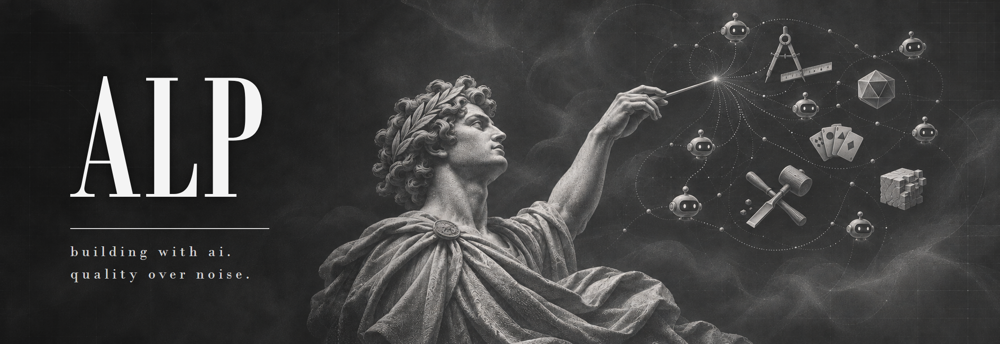

  

I'm **Alp**. I build with AI every day: a mobile game, and the systems around it that keep the work fast and honest — memory, tools, and a pair of hands for my computer.

I'm after quality over noise, and I'd rather ship one thing properly than announce ten.

## Start here

| | |
|---|---|
| **01 / GAME** **[Al Sat](https://github.com/TheRealAlperN/al-sat-showcase)** An offline mobile car-dealer simulation and RPG, in development. | **02 / MEMORY** **A personal second brain** Obsidian and Claude Code, so context survives between sessions. Built on Avenox's open-source [Beyin](https://github.com/avenoxai/avenoxbeyin). |
| **03 / HANDS** **Akıl** A local agent layer that does computer work for me: files, installs, small tools. In development, private. | |
